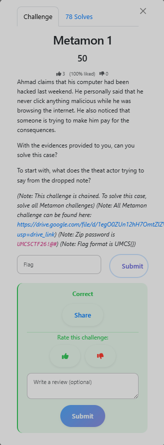

# Metamon 1 — The Ransom Note

**Category:** DFIR

**Flag:** `UMCS{3z_f1rs7_glaf_4t_r4nsom_n0T3}`

## Series Overview

> *"Ahmad claims that his computer had been hacked last weekend. He personally said that he never clicked anything malicious while he was browsing the internet. He also noticed that someone is trying to make him pay for the consequences. With the evidence provided to you, solve the full Metamon case."*

Evidence file: `WORK-PC-AHMAD-FOR.ad1` (Windows disk image)
ZIP password: `UMCSCTF2026#`

## Objective



What is the threat actor trying to say from the dropped note?

## Solution

Opening the AD1 image in Autopsy (or FTK Imager), the Desktop contains a `README.txt` file. Its content appears garbled initially — it's Base64-encoded:

```bash
echo "<blob>" | base64 -d
# UMCS{3z_f1rs7_glaf_4t_r4nsom_n0T3}
```

## Flag

```
UMCS{3z_f1rs7_glaf_4t_r4nsom_n0T3}
```
