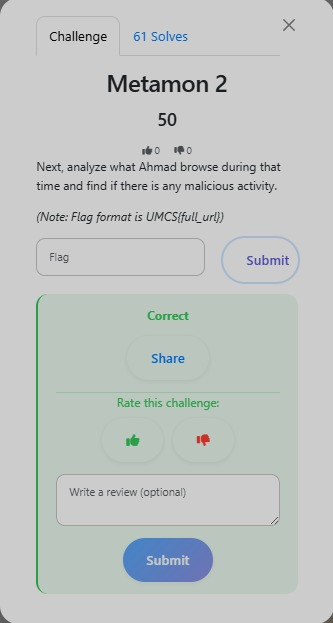

# Metamon 2 — Browser History

**Category:** DFIR

**Flag:** `UMCS{<https://pinarat.github.io/a/>}`

## Objective



Identify the malicious URL Ahmad visited.

## Solution

Ahmad's Edge browser history is stored at:

```
C:\Users\ahmad\AppData\Local\Microsoft\Edge\User Data\Default\History
```

Exporting and reviewing the `urls` and `visits` tables around the compromise window reveals that Ahmad visited a fake reCAPTCHA page:

```
https://pinarat.github.io/a/
```

This is the classic **ClickFix** social engineering pattern — a fake reCAPTCHA that tricks users into pressing Win+R and pasting a malicious PowerShell command.

## Flag

```
UMCS{<https://pinarat.github.io/a/>}
```
