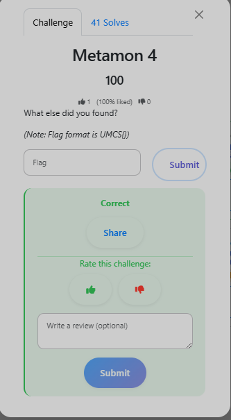

# Metamon 4 — Steganography Payload

**Category:** DFIR
**Flag:** `UMCS{STay_1N_7hE_M1dDLe,l1kE_Y0U_A_LiTlLE,DONt_Want_NO_RidD1E}`

## Objective



What else did you find?

## Solution

The batch file stages download `profile.png`. This PNG contains an embedded PowerShell script hidden in the pixel data.

The extraction algorithm:

- Pixels 0 and 1 encode the payload size (R, G, B, and R values form a 32-bit integer via bitshifts).
- Starting from pixel 2, the R, G, B bytes of each pixel are raw payload bytes.
- The extracted byte stream is XOR-decrypted with key `54c6739d170de582` (hardcoded in the stager, obfuscated with ROT-24).
- The result is GZIP-decompressed to yield the Stage 2 PowerShell script.

The decompressed Stage 2 PowerShell contains the flag as a string literal:

```powershell
$ebnV3ty = 'UMCS{STay_1N_7hE_M1dDLe,l1kE_Y0U_A_LiTlLE,DONt_Want_NO_RidD1E}'
```

## Flag

```
UMCS{STay_1N_7hE_M1dDLe,l1kE_Y0U_A_LiTlLE,DONt_Want_NO_RidD1E}
```

Pixel-level steganography combined with XOR + GZIP is a real delivery technique. The ROT-24 obfuscation of the XOR key is a minor hurdle — recognise the pattern and it falls quickly.
