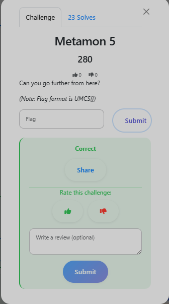

# Metamon 5 — Discord C2

**Category:** DFIR

**Flag:** `UMCS{Me7amoN_t4p4u3d_8y_y0u_}`

## Objective



Can you go further from here?

## Solution

Stage 2 PowerShell downloads and executes `Ditto.exe` — a PyInstaller-bundled Python binary.

Unpacking with `pyinstxtractor` and decompiling the `.pyc` files reveals a Discord bot C2 client with hard-coded credentials:

```python
BOT_TOKEN    = "8730354227:AAGNzcTfCMxNG-w_FDO-rZkqDyVeLMLK414"
ATTACKER_CHAT = "1421332625"
```

Using the bot token to query the Discord API and dumping the attacker's `#cybershit` channel reveals a Base64-encoded message:

```
VU1DU3tNZTdhbW9OX3Q0cDR1M2RfOHlfeW91X30=
```

Decoding:

```bash
echo "VU1DU3tNZTdhbW9OX3Q0cDR1M2RfOHlfeW91X30=" | base64 -d
# UMCS{Me7amoN_t4p4u3d_8y_y0u_}
```

## Flag

```
UMCS{Me7amoN_t4p4u3d_8y_y0u_}
```

Discord-based C2 is actively used in commodity malware — it blends into normal HTTPS traffic and abuses a trusted platform. Hard-coded bot tokens in PyInstaller binaries are recoverable with `pyinstxtractor` + any Python decompiler.
