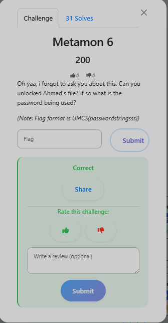

# Metamon 6 — Locked Archive Password

**Category:** DFIR

**Flag:** `UMCS{GcJqVl9YaVwBIPC4nbOW}`

## Objective



Can you unlock Ahmad's file? If so, what password was used?

## Solution

On Ahmad's Desktop is `LOCKED.7z`. A memory dump (`memdump.mem`) is also present in the image.

Windows stores recently executed command lines in memory as UTF-16 Little-Endian. Using `strings -el` to find them:

```bash
strings -el memdump.mem | grep -i "important.txt" -B 5 -A 5
# cmd.exe /c "7z.exe" a "C:\Users\ahmad\Desktop\LOCKED.7z"
#     "C:\Users\ahmad\Desktop\Me\important.txt"
#     -pGcJqVl9YaVwBIPC4nbOW -mhe=on
```

The `-p` flag reveals the 7-Zip password directly from the attacker's command line.

Extracting `LOCKED.7z` with password `GcJqVl9YaVwBIPC4nbOW` succeeds.

## Flag

```
UMCS{GcJqVl9YaVwBIPC4nbOW}
```

Memory forensics is a powerful technique for recovering attacker command lines. Even after a process exits, its command-line arguments often persist in memory pages until overwritten.
