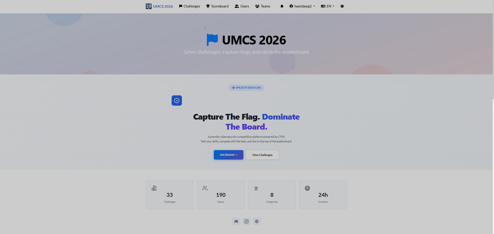
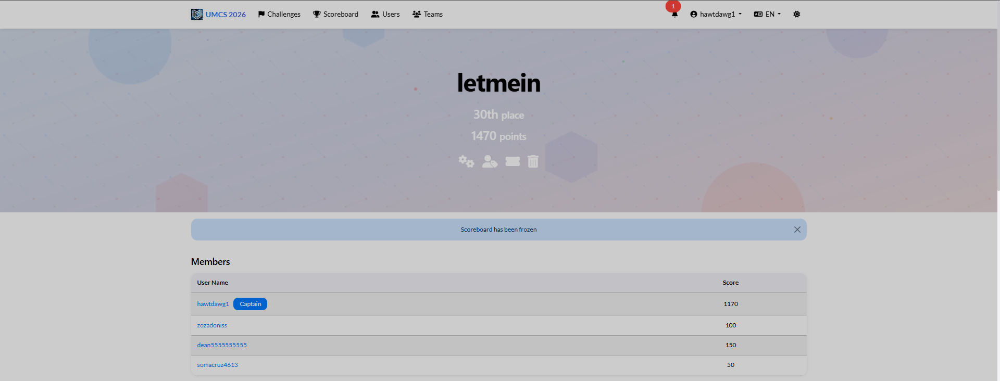

# UMCS CTF 2026

Managed to placed 30th out of 190 teams personally solving 18/33 challenges within 24 hours.

Solved the following challenges:

| Category | Challenge |
| :---: | :---: |
| Crypto | [The Hexed Protocol](The%20Hexed%20Protocol) |
| Crypto | [Makmal Buta, UM](Makmal%20Buta%2C%20UM) |
| Crypto | [Ghost in the Radio](Ghost%20in%20the%20Radio) |
| Crypto | [Phantom Anthem of DTC](Phantom%20Anthem%20of%20DTC) |
| Crypto | [Zip-a-Dip-Doo-Dah](Zip-a-Dip-Doo-Dah) |
| Reverse Engineering | [Varsity Lake Sonata](Varsity%20Lake%20Sonata) |
| Binary Exploitation | [Cyber BlindBox](Cyber%20BlindBox) |
| Binary Exploitation | [Black Flash](Black%20Flash) |
| Binary Exploitation | [Spinning Cat](Spinning%20Cat) |
| Forensics | [Shadow_Ops](Shadow_Ops) |
| Web | [I-DO The Veiled Vow](I-DO%20The%20Veiled%20Vow) |
| DFIR | [Metamon 1](Metamon%201) |
| DFIR | [Metamon 2](Metamon%202) |
| DFIR | [Metamon 3](Metamon%203) |
| DFIR | [Metamon 4](Metamon%204) |
| DFIR | [Metamon 5](Metamon%205) |
| DFIR | [Metamon 6](Metamon%206) |
| DFIR | [Metamon 7](Metamon%207) |
