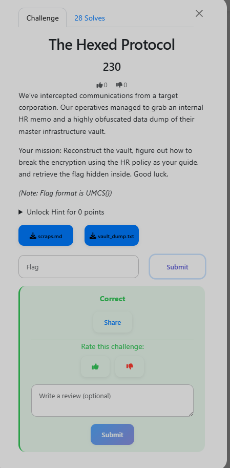

# The Hexed Protocol

**Category:** Crypto
**Flag:** `UMCS{m4sk_4tt4cks_b34t_brut3_f0rc3}`

## Challenge Overview



> *"We've intercepted communications from a target corporation. Our operatives managed to grab an internal HR memo and a highly obfuscated data dump of their master infrastructure vault. Your mission: Reconstruct the vault, figure out how to break the encryption using the HR policy as your guide, and retrieve the flag hidden inside."*

Two files were provided: `scraps.md` (an HR policy memo) and `vault_dump.txt` (a long hex string).

## Initial Enumeration / Recon

Opening `scraps.md`, the document reads like a perfectly mundane internal HR notice:

```
HR is enforcing the new 2025 Password Matrix for all local vaults.
Passwords must strictly follow this format:

[Core Company Value] + [4-Digit Department PIN] + [One Special Character]

Remember: Only capitalize the first letter of the Core Value.
The core values are: SYNERGY, DISRUPTION, PIVOT, AGILITY, PARADIGM.
```

So the password space is well-defined: one of five proper-cased words, followed by a four-digit PIN (0000–9999), followed by a single special character. That's 5 × 10,000 × 32 ≈ 1.6 million combinations — totally bruteforceable.

Next, `vault_dump.txt` is a wall of hexadecimal. The first step is converting it back to binary:

```bash
xxd -r -p vault_dump.txt > vault_dump.bin
file vault_dump.bin
# vault_dump.bin: Keepass password database 2.x KDBX
```

A KeePass 2.x KDBX database. Before cracking, extract the hash into a format John the Ripper understands:

```bash
keepass2john vault_dump.bin > keepass.hash
```

## Exploitation Steps

**Step 1 — Generate a targeted wordlist:**

```python
import string

bases    = ["Synergy", "Disruption", "Pivot", "Agility", "Paradigm"]
specials = string.punctuation

with open("wordlist.txt", "w") as f:
    for base in bases:
        for i in range(10000):
            pin = f"{i:04d}"
            for s in specials:
                f.write(f"{base}{pin}{s}\n")
```

This produces exactly 1,600,000 candidates.

**Step 2 — Run John the Ripper:**

```bash
john --wordlist=wordlist.txt keepass.hash
```

Within about 90 seconds, John finds the password:

```
Paradigm4092@    (vault_dump.bin)
```

**Step 3 — Open the database:**

```bash
python3 open.py
# Title: Master Infrastructure
# Notes: UMCS{m4sk_4tt4cks_b34t_brut3_f0rc3}
```

## Flag

```
UMCS{m4sk_4tt4cks_b34t_brut3_f0rc3}
```

Password policies that follow predictable templates (word + digits + symbol) shrink the effective keyspace dramatically. If you can infer the structure from a leaked document, a targeted wordlist will always beat a generic rockyou attack.
